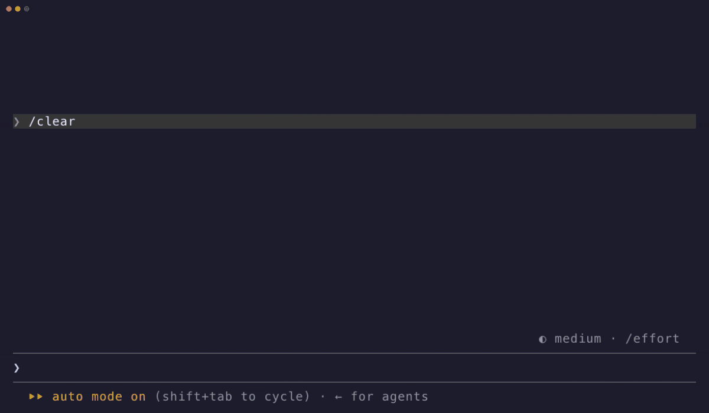
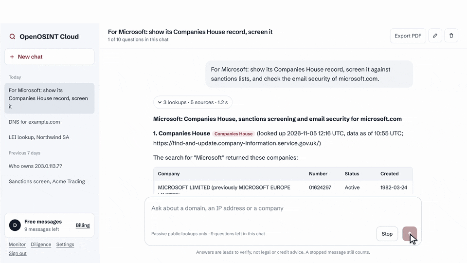
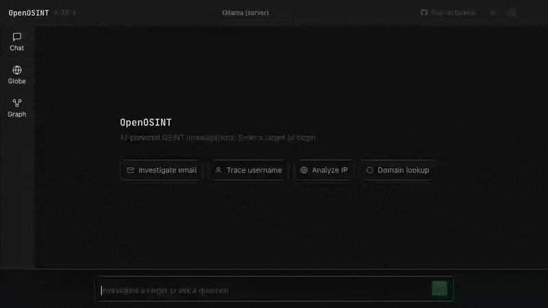

mcp-name: io.github.OpenOSINT/openosint

<div align="center">
  
  <h1>OpenOSINT</h1>
  <p><strong>The OSINT toolkit for AI agents: Agent Skill, MCP server and CLI. Passive by default, no API keys needed to start, and every finding cites the tool call that produced it.</strong></p>
</div>

<div align="center">

[](https://github.com/OpenOSINT/OpenOSINT/releases)
[](https://pypi.org/project/openosint/)
[](LICENSE)
[](https://registry.modelcontextprotocol.io/servers/io.github.OpenOSINT/openosint)
[](https://www.ip2location.io/?utm_source=openosint&utm_medium=readme&utm_campaign=ip2location)
[](https://www.testmuai.com/?utm_source=openosint&utm_medium=opensourcecollab)



*A real Claude Code session, nothing mocked: install the plugin and run a passive recon on `example.com`. [Sharper MP4](assets/demo/skill-demo.mp4).*

</div>

## Quickstart

Needs [`uv`](https://docs.astral.sh/uv/). No API keys for the default flow.

**Claude Code plugin** (skills plus a passive MCP server):

```text
/plugin marketplace add OpenOSINT/OpenOSINT
/plugin install openosint@openosint
/openosint:osint example.com
```

**Any agent** (Codex, Gemini CLI, Cursor and other Agent Skills clients):

```bash
npx skills add OpenOSINT/OpenOSINT
```

**MCP server or pip** ([other clients](https://openosint.tech/docs/mcp/)):

```bash
claude mcp add openosint -- uvx --from openosint openosint-mcp
pip install openosint && openosint exposure example.com
```

## OpenOSINT Cloud

The same engine as a hosted chat: ask about a domain, an IP address or a company. Every answer shows which public sources were checked, when, and a source on every claim. No install, no API keys.

<a href="https://chat.openosint.tech/?utm_source=github&utm_medium=readme&utm_campaign=cloud_demo"></a>

[Try it: 10 free messages](https://chat.openosint.tech/?utm_source=github&utm_medium=readme&utm_campaign=cloud_demo)

## What you can do

Real output, captured 2026-11-04 on v2.37.0 and trimmed. None of these commands needs an API key or an AI provider.

```text
$ openosint exposure example.com
Grade: B  Score: 88/100
Checks:  email OK [passive] · registration OK [passive] · tls OK [touches target] · http_headers OK [touches target]
  [LOW] DMARC has no aggregate report address (dmarc_no_rua)
  [LOW] Strict-Transport-Security header missing (hsts_missing)
  [INFO] Domain registered 31.2 years ago (domain_age)

$ openosint dns example.com
[DNS] NS: elliott.ns.cloudflare.com., hera.ns.cloudflare.com.
[DNS] SPF: v=spf1 -all
[DNS] DMARC: "v=DMARC1;p=reject;sp=reject;adkim=s;aspf=s"
[DNS] DKIM not checked: selector probing is enumeration (needs --allow-active).

$ openosint rdap example.com
[+] Registrar: RESERVED-Internet Assigned Numbers Authority
[+] Registered: 1995-08-14T04:00:00Z
[+] Expires: 2027-08-13T04:00:00Z
[+] Name servers: elliott.ns.cloudflare.com, hera.ns.cloudflare.com

$ openosint ip 8.8.8.8
[+] Hostname: dns.google
[+] Org: AS15169 Google LLC
[+] City: Mountain View

$ openosint gdelt example.com
No geolocated coverage found for 'example.com'. Coverage: the last 15 min (...)
$ openosint gdelt ukraine
[+] White House, District Of Columbia, United States (38.8951, -77.0364) — 1 article(s)
```

The same commands are what the skill runs for an agent. All of them are in the [CLI reference](https://openosint.tech/docs/cli/).

## Why OpenOSINT

- **Real tool executions.** Tools are Python code; only their actual output reaches the model.
- **Provenance.** Every finding is shown with the tool call that produced it. AI summaries are leads to verify, not proof.
- **Passive by default, with noise labels.** Tools that touch the target or are noisy are not even offered to the agent until you opt in.
- **Works with no keys.** `exposure`, `dns`, `rdap`, `whois`, `ip`, `gdelt` and `dorks` need no account.

| | Prompt-only OSINT skills | SpiderFoot | OpenOSINT |
|---|---|---|---|
| What runs the lookups | Nothing: the skill is instructions, and the agent improvises | Its own 200+ modules | Python tools shipped with it |
| Breadth | Whatever the agent can reach | Much broader: 200+ modules and a correlation engine, per its README | A focused tool set |
| Built to be driven by an agent | Yes, that is the format | Web UI or CLI, per its README | Agent Skill, Claude Code plugin, MCP server, CLI and web UI |
| Passive/noisy labels, off by default | No | Not claimed here | Yes, per tool |
| License | Varies | MIT | MIT |

SpiderFoot is the better choice when you want a large standalone scanner. OpenOSINT is for agents that need a small set of real, labelled tools.

## Tools

Level is the noise label: `passive` tools are on by default; anything else needs `--allow-active`. Per-tool docs: [openosint.tech/tools](https://openosint.tech/tools/).

| Tool | Source | Level | Key needed |
|---|---|---|---|
| [`search_dns`](https://openosint.tech/tools/#search_dns) | dnspython (built-in) | passive | No |
| [`search_rdap`](https://openosint.tech/tools/#search_rdap) | RDAP (IANA bootstrap) | passive | No |
| [`search_whois`](https://openosint.tech/tools/#search_whois) | python-whois | passive | No |
| [`search_ip`](https://openosint.tech/tools/#search_ip) | ipinfo.io | passive | Optional |
| [`search_ip2location`](https://openosint.tech/tools/#search_ip2location) | IP2Location API *(sponsored)* | passive | Required |
| [`search_gdelt_geo`](https://openosint.tech/tools/#search_gdelt_geo) | GDELT 15-minute GKG feed | passive | No |
| [`generate_dorks`](https://openosint.tech/tools/#generate_dorks) | built-in | passive | No |
| [`search_paste`](https://openosint.tech/tools/#search_paste) | psbdmp.ws | passive | No |
| [`search_github`](https://openosint.tech/tools/#search_github) | GitHub REST API | passive | Optional |
| [`search_breach`](https://openosint.tech/tools/#search_breach) | HaveIBeenPwned API | passive | Required |
| [`search_shodan`](https://openosint.tech/tools/#search_shodan) | Shodan API | passive | Required |
| [`search_censys`](https://openosint.tech/tools/#search_censys) | Censys API | passive | Required |
| [`search_virustotal`](https://openosint.tech/tools/#search_virustotal) | VirusTotal API | passive | Required |
| [`search_abuseipdb`](https://openosint.tech/tools/#search_abuseipdb) | AbuseIPDB v2 API | passive | Required |
| [`search_dorks_live`](https://openosint.tech/tools/#search_dorks_live) | [Bright Data SERP API](https://get.brightdata.com/jx2wfi?sid1=readme&sid2=setup&sid3=search_dorks_live&utm_source=openosint&utm_medium=readme&utm_campaign=setup&utm_content=search_dorks_live)¹ | passive | Required |
| [`search_footprint`](https://openosint.tech/tools/#search_footprint) | [Bright Data SERP API](https://get.brightdata.com/jx2wfi?sid1=readme&sid2=setup&sid3=search_footprint&utm_source=openosint&utm_medium=readme&utm_campaign=setup&utm_content=search_footprint)¹ | passive | Required |
| [`scrape_url`](https://openosint.tech/tools/#scrape_url) | [Bright Data Web Unlocker](https://get.brightdata.com/openosint-unlocker?sid1=readme&sid2=setup&sid3=scrape_url&utm_source=openosint&utm_medium=readme&utm_campaign=setup&utm_content=scrape_url)¹ | touches target | Required |
| [`search_username`](https://openosint.tech/tools/#search_username) | sherlock | noisy | No |
| [`search_email`](https://openosint.tech/tools/#search_email) | holehe | noisy | No |
| [`search_domain`](https://openosint.tech/tools/#search_domain) | sublist3r | noisy | No |
| [`search_phone`](https://openosint.tech/tools/#search_phone) | phoneinfoga | unverified | No |

Sherlock, holehe, sublist3r and phoneinfoga are wrapped as local binaries; install them yourself and enable active tools to use them.

Setting up the three Bright Data tools: [Using OpenOSINT with Bright Data](https://openosint.tech/docs/bright-data/).

## Passive by default

Agents and MCP clients are only offered tools that query third-party data sources or compute locally. Anything that touches the target or sends many requests from your IP is **off until you opt in**, and is not listed in an MCP client's `tools/list` at all.

| Level | Meaning |
|---|---|
| passive | Queries third-party sources or computes locally; nothing is sent to the target's own infrastructure (standard DNS goes through your resolver) |
| touches target | The target's infrastructure can see the request |
| noisy | High request volume; expect rate limits, blocks and alerts |
| unverified | Network behavior not yet confirmed by a traffic capture; treated as non-passive |
| inherits | A fan-out tool that only runs what the current mode allows |

Enable active tools with `openosint --allow-active …`, `OPENOSINT_ALLOW_ACTIVE=1`, Web UI Settings (loopback only), or `openosint-mcp --allow-active`. Passive is not private: every service you query sees the query. Per-tool "what it sends" table and the tool-call cap: [Safety](https://openosint.tech/docs/safety/).

## Go deeper

### Web UI + globe

`openosint web` starts a local browser app with streaming chat, tool cards, a news globe and a graph view. [Docs](https://openosint.tech/docs/web-ui/).



*An agent investigation landing live on the globe; click a point to pivot. [Sharper MP4](docs/assets/globe-demo.mp4) · [Live demo](https://demo.openosint.tech) (bring your own key, no signup).*

### Entity graph

A FollowTheMoney entity graph with statement-level provenance and a human review queue for `same_as` candidates. [Docs](https://openosint.tech/docs/entity-graph/).

### External exposure report (beta)

`openosint exposure example.com` grades email authentication, TLS, registration and security headers A to F. [Docs](https://openosint.tech/docs/exposure/).

### Installation

`pip install openosint`, or run without installing: `uvx openosint web`. Python 3.10+. [Install guide](https://openosint.tech/docs/install/).

### MCP Server

Works in Claude Desktop, Claude Code, Cursor and any MCP client: `uvx --from openosint openosint-mcp`. [Client configs](https://openosint.tech/docs/mcp/).

### Configuration

Keys go in the web UI Settings, `~/.openosint/config.env` or the environment; the app starts with none. [All variables](https://openosint.tech/docs/configuration/) · [CLI reference](https://openosint.tech/docs/cli/) · [Limitations](https://openosint.tech/docs/troubleshooting/#limitations).

### Docker

`docker compose up --build`, then open <http://localhost:8080>. [Docker notes](https://openosint.tech/docs/web-ui/#docker).

> **Moved from this README:** per-tool details are at [openosint.tech/tools](https://openosint.tech/tools/); CLI flags (old `#cli-reference`) at [/docs/cli](https://openosint.tech/docs/cli/); limitations (`#limitations`) at [/docs/troubleshooting](https://openosint.tech/docs/troubleshooting/#limitations); integrations (`#integrations`) at [/tools](https://openosint.tech/tools/#integrations); the graph module (`#graph-module-optional`) at [/docs/entity-graph](https://openosint.tech/docs/entity-graph/).

## Hosted versions

Built on this engine. The open-source project stays free and MIT-licensed.

- **[Cloud](https://chat.openosint.tech/?utm_source=github&utm_medium=readme&utm_campaign=hosted_versions)**: chat about a domain, an IP address or a company, with sourced answers. [Details above](#openosint-cloud).
- **[Monitor](https://app.openosint.tech/monitor?utm_source=github&utm_medium=readme&utm_campaign=hosted_versions)**: domain security monitoring (SPF, DKIM, DMARC, TLS). Free for one domain.
- **[Diligence](https://app.openosint.tech/diligence?utm_source=github&utm_medium=readme&utm_campaign=hosted_versions)**: UK and LEI company checks against registries and sanctions lists.
- **API access (by request)**: hosted REST and MCP API. Email [commercial@openosint.tech](mailto:commercial@openosint.tech).

## Sponsors

<!-- SPONSORS:START -->

### Featured Integrations

<a href="https://www.ip2location.io/?utm_source=openosint&utm_medium=readme&utm_campaign=ip2location" rel="noopener sponsored"></a>

**[IP2Location.io](https://www.ip2location.io/?utm_source=openosint&utm_medium=readme&utm_campaign=ip2location)** — powers `search_ip2location` · [Integration guide](docs/integrations/ip2location.md)

> Enhanced IP geolocation, ISP, VPN/Proxy/Tor, and datacenter detection

<a href="https://www.testmuai.com/?utm_source=openosint&utm_medium=opensourcecollab" rel="noopener sponsored"><picture><source media="(prefers-color-scheme: dark)" srcset="https://raw.githubusercontent.com/OpenOSINT/OpenOSINT/main/assets/sponsors/testmu-ai-white.svg"></picture></a>

**[TestMu AI](https://www.testmuai.com/?utm_source=openosint&utm_medium=opensourcecollab)**

> TestMu AI (formerly LambdaTest) is an AI-native testing cloud platform built for modern engineering teams. It covers everything from autonomous test creation and fast execution to testing AI agents, chatbots and voice assistants.

_Open: Breach / Compromised-Credential Data · Email / Identity Lookup · Residential Proxies — see [SPONSORSHIP.md](SPONSORSHIP.md)._

<!-- SPONSORS:END -->

Sponsor on [Open Collective](https://opencollective.com/openosint_oss) · tiers in [SPONSORSHIP.md](SPONSORSHIP.md) · commercial license and support: [COMMERCIAL.md](./COMMERCIAL.md).

## Contributing

Issues and pull requests are welcome. See [CONTRIBUTING.md](CONTRIBUTING.md) (workflow, demo regeneration, conventions) and read [DISCLAIMER.md](DISCLAIMER.md) first. Maintainer: [Tommaso Bertocchi](https://x.com/SonoTommy_) · [@openosint_oss](https://x.com/openosint_oss) · commercial@openosint.tech. Contributors: [@consocio](https://github.com/consocio) ([#6](https://github.com/OpenOSINT/OpenOSINT/pull/6)).

## License

MIT. See [LICENSE](./LICENSE). For authorized security research only; see [DISCLAIMER.md](DISCLAIMER.md).

¹ Bright Data links in this README are affiliate/referral links: OpenOSINT earns a commission if you sign up through them, at no extra cost to you.

*OpenOSINT v2.38.0 — November 2026*

## Star History

[](https://star-history.com/#OpenOSINT/OpenOSINT&Date)
