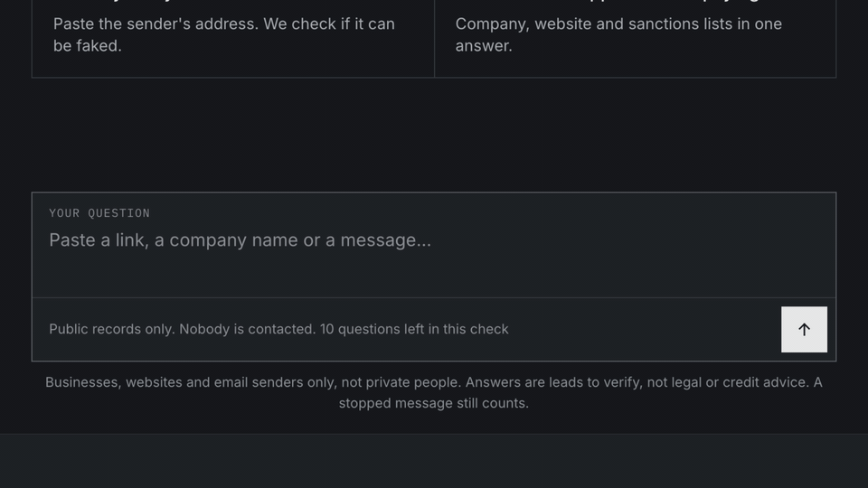

<!-- mcp-name: io.github.OpenOSINT/openosint -->

<div align="center">
  
  <p><strong>OpenOSINT is an open-source OSINT agent for investigators and security researchers: 21 public-source tools behind a natural-language interface, with an MCP server.</strong></p>
</div>

<div align="center">

[](https://github.com/OpenOSINT/OpenOSINT/releases)
[](https://pypi.org/project/openosint/)
[](LICENSE)
[](https://registry.modelcontextprotocol.io/servers/io.github.OpenOSINT/openosint)
[](https://www.ip2location.io/?utm_source=openosint&utm_medium=readme&utm_campaign=ip2location)
[](https://www.testmuai.com/?utm_source=openosint&utm_medium=opensourcecollab)



**Run it yourself:** `uvx openosint web` (one command, no keys)<br>
**No terminal?** Use [OpenOSINT Cloud](https://app.openosint.tech/?utm_source=github&utm_medium=readme&utm_campaign=hero) in your browser, first check free

[Docs](https://openosint.tech/docs/) · [Claude Code plugin](#use-it-from-claude-code-or-any-mcp-client) · [MCP server](https://openosint.tech/docs/mcp/) · [Live demo](https://demo.openosint.tech)

</div>

## Quickstart

Needs [`uv`](https://docs.astral.sh/uv/). No API keys for these commands.

```bash
# Local web app with chat, graph and globe
uvx openosint web

# Or one direct check, no AI involved
uvx openosint exposure example.com
```

```text
Grade: B  Score: 88/100
Checks: email OK, registration OK (passive)
        tls OK, http_headers OK (these touch the target)
  [LOW] DMARC has no aggregate report address (dmarc_no_rua)
  [LOW] Strict-Transport-Security header missing (hsts_missing)
```

Real output, trimmed and re-wrapped. More commands: [CLI reference](https://openosint.tech/docs/cli/) · [install guide](https://openosint.tech/docs/install/).

## What you can do

Moved to [Quickstart](#quickstart) above and the [CLI reference](https://openosint.tech/docs/cli/).

## Tools

What it can look up. Per-tool docs: [openosint.tech/tools](https://openosint.tech/tools/). Only passive tools are on by default.

| Tool | What it finds | Key needed |
|---|---|---|
| [`search_dns`](https://openosint.tech/tools/#search_dns) | DNS records, SPF, DMARC | No |
| [`search_rdap`](https://openosint.tech/tools/#search_rdap) | Registrar, dates, name servers (RDAP) | No |
| [`search_whois`](https://openosint.tech/tools/#search_whois) | WHOIS registration data | No |
| [`search_ip`](https://openosint.tech/tools/#search_ip) | Hostname, ASN, city for an IP | Optional |
| [`search_ip2location`](https://openosint.tech/tools/#search_ip2location) | Geolocation, ISP, proxy/VPN/Tor flags *(sponsored)* | Yes |
| [`search_gdelt_geo`](https://openosint.tech/tools/#search_gdelt_geo) | Geolocated news mentions (GDELT) | No |
| [`generate_dorks`](https://openosint.tech/tools/#generate_dorks) | Search-dork URLs for a target | No |
| [`search_paste`](https://openosint.tech/tools/#search_paste) | Paste-site mentions | No |
| [`search_github`](https://openosint.tech/tools/#search_github) | Repos, code and users | Optional |
| [`search_breach`](https://openosint.tech/tools/#search_breach) | Breaches for an email (HaveIBeenPwned) | Yes |
| [`search_shodan`](https://openosint.tech/tools/#search_shodan) | Open ports and banners | Yes |
| [`search_censys`](https://openosint.tech/tools/#search_censys) | Hosts and certificates | Yes |
| [`search_virustotal`](https://openosint.tech/tools/#search_virustotal) | URL, domain and IP reputation | Yes |
| [`search_abuseipdb`](https://openosint.tech/tools/#search_abuseipdb) | IP abuse reports | Yes |
| [`search_dorks_live`](https://openosint.tech/tools/#search_dorks_live) | Live dork results via [Bright Data SERP API](https://get.brightdata.com/jx2wfi?sid1=readme&sid2=setup&sid3=search_dorks_live&utm_source=openosint&utm_medium=readme&utm_campaign=setup&utm_content=search_dorks_live)¹ | Yes |
| [`search_footprint`](https://openosint.tech/tools/#search_footprint) | Web footprint via [Bright Data SERP API](https://get.brightdata.com/jx2wfi?sid1=readme&sid2=setup&sid3=search_footprint&utm_source=openosint&utm_medium=readme&utm_campaign=setup&utm_content=search_footprint)¹ | Yes |
| [`scrape_url`](https://openosint.tech/tools/#scrape_url) | Page content via [Bright Data Web Unlocker](https://get.brightdata.com/openosint-unlocker?sid1=readme&sid2=setup&sid3=scrape_url&utm_source=openosint&utm_medium=readme&utm_campaign=setup&utm_content=scrape_url)¹ (touches target) | Yes |
| [`search_username`](https://openosint.tech/tools/#search_username) | Username across platforms (sherlock; noisy) | No |
| [`search_email`](https://openosint.tech/tools/#search_email) | Accounts tied to an email (holehe; noisy) | No |
| [`search_domain`](https://openosint.tech/tools/#search_domain) | Subdomains (sublist3r; noisy) | No |
| [`search_phone`](https://openosint.tech/tools/#search_phone) | Carrier and country (phoneinfoga; unverified) | No |

Sherlock, holehe, sublist3r and phoneinfoga run as local binaries you install yourself. Setting up the Bright Data tools: [Using OpenOSINT with Bright Data](https://openosint.tech/docs/bright-data/).

## Why OpenOSINT

Tools run as real Python code and every finding cites the call that produced it. Compared with SpiderFoot, OpenOSINT has far fewer modules and is built to be driven by an agent. See the [comparison](https://openosint.tech/docs/#compared-with-other-tools).

## Passive by default

Agents and MCP clients are only offered tools that query third-party sources or compute locally. Anything that touches the target or sends many requests from your IP is off until you opt in (`--allow-active`) and is not listed in an MCP client's `tools/list`. Passive is not private: every service you query sees the query. Details: [Safety](https://openosint.tech/docs/safety/).

## Use it from Claude Code or any MCP client

```text
/plugin marketplace add OpenOSINT/OpenOSINT
/plugin install openosint@openosint
/openosint:osint example.com
```

```bash
claude mcp add openosint -- uvx --from openosint openosint-mcp
# Codex, Gemini CLI, Cursor and other Agent Skills clients
npx skills add OpenOSINT/OpenOSINT
```


Other clients: [MCP docs](https://openosint.tech/docs/mcp/) · [Agent Skill](https://openosint.tech/docs/agent-skill/).

## Go deeper

- **Web UI:** `openosint web`, streaming chat, a news globe and a graph view. [Docs](https://openosint.tech/docs/web-ui/)
- **REPL:** `openosint` with no arguments. [CLI reference](https://openosint.tech/docs/cli/)
- **MCP server:** `uvx --from openosint openosint-mcp`. [Client configs](https://openosint.tech/docs/mcp/)

### Web UI + globe

An agent investigation lands as a point on a 3D globe; click it to pivot. [Docs](https://openosint.tech/docs/web-ui/)

### Entity graph

A FollowTheMoney graph with statement-level provenance and a review queue for `same_as` candidates. [Docs](https://openosint.tech/docs/entity-graph/)

### External exposure report (beta)

`openosint exposure example.com` grades email authentication, TLS, registration and security headers A to F. [Docs](https://openosint.tech/docs/exposure/)

### Installation

`pip install openosint` or `uvx openosint web`. Python 3.10+. [Install guide](https://openosint.tech/docs/install/)

### MCP Server

Works in Claude Desktop, Claude Code, Cursor and any MCP client. [Client configs](https://openosint.tech/docs/mcp/)

### Configuration

Keys go in the web UI Settings, `~/.openosint/config.env` or the environment. [All variables](https://openosint.tech/docs/configuration/) · [CLI reference](https://openosint.tech/docs/cli/)

### Docker

`docker compose up --build`, then open <http://localhost:8080>. [Docker notes](https://openosint.tech/docs/web-ui/#docker)

## OpenOSINT Cloud

The same engine as a hosted chat for a domain, an IP address or a company, with a source on every claim. [First check free, no account](https://app.openosint.tech/?utm_source=github&utm_medium=readme&utm_campaign=cloud). Hosted REST and MCP API by request: [commercial@openosint.tech](mailto:commercial@openosint.tech).

## Sponsors

<!-- SPONSORS:START -->

### Featured Integrations

<a href="https://www.ip2location.io/?utm_source=openosint&utm_medium=readme&utm_campaign=ip2location" rel="noopener sponsored"></a>

**[IP2Location.io](https://www.ip2location.io/?utm_source=openosint&utm_medium=readme&utm_campaign=ip2location)** — powers `search_ip2location` · [Integration guide](docs/integrations/ip2location.md)

> Enhanced IP geolocation, ISP, VPN/Proxy/Tor, and datacenter detection

<a href="https://www.testmuai.com/?utm_source=openosint&utm_medium=opensourcecollab" rel="noopener sponsored"><picture><source media="(prefers-color-scheme: dark)" srcset="https://raw.githubusercontent.com/OpenOSINT/OpenOSINT/main/assets/sponsors/testmu-ai-white.svg"></picture></a>

**[TestMu AI](https://www.testmuai.com/?utm_source=openosint&utm_medium=opensourcecollab)**

> TestMu AI (formerly LambdaTest) is an AI-native testing cloud platform built for modern engineering teams. It covers everything from autonomous test creation and fast execution to testing AI agents, chatbots and voice assistants.

_Open: Breach / Compromised-Credential Data · Email / Identity Lookup · Residential Proxies — see [SPONSORSHIP.md](SPONSORSHIP.md)._

<!-- SPONSORS:END -->

Sponsor on [Open Collective](https://opencollective.com/openosint_oss) · tiers in [SPONSORSHIP.md](SPONSORSHIP.md) · commercial license and support: [COMMERCIAL.md](./COMMERCIAL.md).

## Contributing

Issues and pull requests are welcome. See [CONTRIBUTING.md](CONTRIBUTING.md). Maintainer: [Tommaso Bertocchi](https://x.com/SonoTommy_) · [@openosint_oss](https://x.com/openosint_oss). Contributors: [@consocio](https://github.com/consocio) ([#6](https://github.com/OpenOSINT/OpenOSINT/pull/6)).

## Legal Disclaimer

For authorized security research and educational use only. Only investigate targets you own or are permitted to assess. Passive does not mean anonymous. Full text: [DISCLAIMER.md](DISCLAIMER.md).

## License

MIT. See [LICENSE](./LICENSE).

¹ Bright Data links in this README are affiliate/referral links: OpenOSINT earns a commission if you sign up through them, at no extra cost to you.

## Star History

[](https://star-history.com/#OpenOSINT/OpenOSINT&Date)
